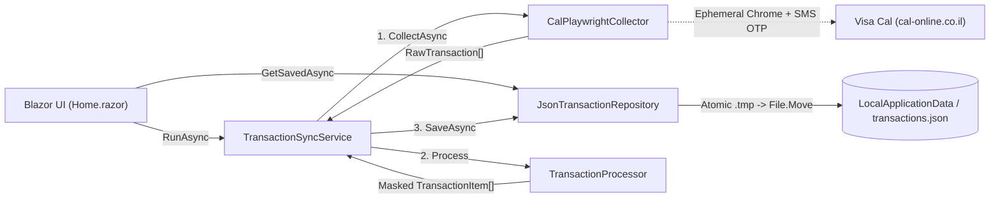

# SumitScraper


`SumitScraper` is an ASP.NET Core (.NET 10) Interactive Server Blazor application that collects credit card transactions from Visa Cal (`cal-online.co.il`) using `Microsoft.Playwright`, normalizes and masks sensitive descriptions in memory, persists masked records atomically as JSON outside the repository, and renders them in an interactive table.

---

## Architecture & Responsibility Boundaries

All dependencies point inward toward provider-neutral contracts in [`src/SumitScraper/Contracts`](src/SumitScraper/Contracts):



| Layer | Files | Responsibility |
|---|---|---|
| **Contracts** | [`TransactionContracts.cs`](src/SumitScraper/Contracts/TransactionContracts.cs) | Provider-neutral records (`BillingPeriod`, `RawTransaction`, `TransactionItem`), `CollectionPhase`, and `ITransactionCollector` / `ITransactionProcessor` / `ITransactionRepository` interfaces. |
| **Data Collection** | [`CalPlaywrightCollector.cs`](src/SumitScraper/Collection/CalPlaywrightCollector.cs), [`CalStatementParser.cs`](src/SumitScraper/Collection/CalStatementParser.cs) | Launches desktop Chrome/Edge in an ephemeral context, waits for user login + SMS OTP, dismisses post-login modals, opens Visa Cal's 90-day transactions view, and extracts `RawTransaction` items from JSON responses (with a DOM row fallback). |
| **Data Processing** | [`TransactionProcessor.cs`](src/SumitScraper/Processing/TransactionProcessor.cs) | Normalizes Israeli dates (`dd/MM/yyyy`, `dd.MM.yyyy`, ISO) to `DateOnly`, applies debit/credit signs, standardizes currencies (`₪`/`$`/`€` to ISO codes), sorts newest-first, and masks descriptions + digits in memory. |
| **Data Storage** | [`JsonTransactionRepository.cs`](src/SumitScraper/Storage/JsonTransactionRepository.cs) | Atomically writes indented UTF-8 JSON (preserving readable Hebrew letters) via a same-directory `.tmp` write + `File.Move(..., overwrite: true)` under `LocalApplicationData`. |
| **Orchestration** | [`TransactionSyncService.cs`](src/SumitScraper/Orchestration/TransactionSyncService.cs) | Enforces single-flight execution via `SemaphoreSlim(1, 1)` and skips `SaveAsync` on cancellation, timeout, or error so previously saved transactions remain intact. |
| **Web UI** | [`Home.razor`](src/SumitScraper/Components/Pages/Home.razor), [`app.css`](src/SumitScraper/wwwroot/app.css) | Blazor Interactive Server dashboard with period selector (`Previous Month` default, `Current Month`, `Last 90 Days`), Collect/Cancel controls, live 4-step pipeline indicator, and RTL/LTR-aligned table. |

---

## Repository Structure

```text
SumitScraper.slnx
src/SumitScraper/
├── Collection/
│   ├── CalPlaywrightCollector.cs
│   └── CalStatementParser.cs
├── Components/
│   ├── App.razor
│   ├── Routes.razor
│   ├── _Imports.razor
│   └── Pages/Home.razor
├── Contracts/
│   └── TransactionContracts.cs
├── Orchestration/
│   └── TransactionSyncService.cs
├── Processing/
│   └── TransactionProcessor.cs
├── Storage/
│   └── JsonTransactionRepository.cs
├── wwwroot/app.css
├── Program.cs
└── appsettings.json
tests/SumitScraper.Tests/
├── JsonTransactionRepositoryTests.cs
├── TransactionProcessorTests.cs
└── TransactionSyncServiceTests.cs
```

---

## Quick Start

### Prerequisites

- **.NET 10 SDK** (`10.0+`)
- **Google Chrome** or **Microsoft Edge** installed locally (`Playwright` launches the installed desktop browser directly — no separate browser binary download is required)

### 1. Build & Run Unit Tests

```bash
dotnet build SumitScraper.slnx --configuration Release
dotnet test SumitScraper.slnx --configuration Release
```

### 2. Run the Application

```bash
dotnet run --project src/SumitScraper
```

### 3. Collect & Browse Transactions

1. Open **http://localhost:5280** in your browser (**Previous Month** is selected by default).
2. Click **Collect Transactions** — a compact desktop browser window opens to Visa Cal (`digital-web.cal-online.co.il`).
3. Complete your Visa Cal login and SMS OTP directly inside that browser window.
4. Once authenticated, `SumitScraper` dismisses any post-login modal, opens **"See all transactions"** (**"לכל העסקאות"**), captures the 90-day statement, and closes the popup browser window automatically.
5. Masked records are saved to disk, reloaded from JSON, and displayed in the table. Switch between **Previous Month**, **Current Month**, and **Last 90 Days — All Saved** instantly without logging in again.

---

## Output JSON Format & Path

By default, masked transactions are written outside the source repository under `Environment.SpecialFolder.LocalApplicationData`:

- **Windows:** `%LocalAppData%\SumitScraper\transactions.json`
- **macOS:** `~/Library/Application Support/SumitScraper/transactions.json`

*(Configurable via `Storage:FilePath` in [`appsettings.json`](src/SumitScraper/appsettings.json) or the `Storage__FilePath` environment variable.)*

Synthetic example of persisted `transactions.json`:

```json
[
  {
    "date": "2026-10-21",
    "amount": -165.40,
    "currency": "ILS",
    "description": "ש***** ד** ס*** ***"
  },
  {
    "date": "2026-10-09",
    "amount": 15.99,
    "currency": "USD",
    "description": "N******.C**"
  }
]
```

---

## Privacy & Security Design

- **Zero credentials or tokens in C#:** Login credentials, card numbers, SMS OTP codes, and session tokens (`calConnectToken`) never enter Blazor inputs, C# models, logs, or disk.
- **Ephemeral browser session:** Uses `NewContextAsync()` (never persistent profiles) with downloads, traces, screenshots, and HAR capture disabled, disposing the browser immediately after capture.
- **In-memory masking before storage:** Every digit (`char.IsDigit`) and every non-leading word letter (`char.IsLetter`) is replaced with `*` in `TransactionProcessor` before `JsonTransactionRepository.SaveAsync` runs.
- **PII-safe console logging:** Logs record only phase transitions, sanitized endpoint paths, item counts, elapsed milliseconds, and exception type names.

---

## Scope & Future Improvements

The current scope focuses on a complete, end-to-end vertical slice with clear separation across Collection, Processing, and Storage, zero-credential interactive authentication, deterministic description masking, atomic JSON persistence, comment-free code, and 40 unit tests over synthetic fixtures.

Potential future improvements include:

1. **Structured PII-Safe Telemetry:** Add Serilog/OpenTelemetry with per-run correlation IDs, structured failure-category metrics, and an external rolling log sink outside the repository.
2. **Card-Type Exposure & Multi-Card Filtering:** Capture and expose the portal's card-type column as an optional property on `RawTransaction` and `TransactionItem` to filter multi-card accounts in the UI.
3. **Original vs. Billed Foreign Currency Breakdown:** Converted foreign-currency purchases (`$`/`€`/`£`) currently display the billed `ILS` amount charged to the card (`debCrdAmt`); extend `RawTransaction` and `TransactionItem` to surface the original deal amount and currency (`trnAmt` / `trnCurrencySymbol` and ISO currency codes) alongside the billed amount.
4. **Reversible Local Description Protection:** Inject `IDataProtectionProvider` into `TransactionProcessor` for optional local owner-only unmasking.
5. **Additional Portals or Export Formats:** Implement additional `ITransactionCollector` providers (e.g., `IsracardPlaywrightCollector`) without modifying `Contracts`, `Processing`, `Storage`, or `Orchestration`, or swap in an `XmlTransactionRepository : ITransactionRepository` in `Program.cs`.
